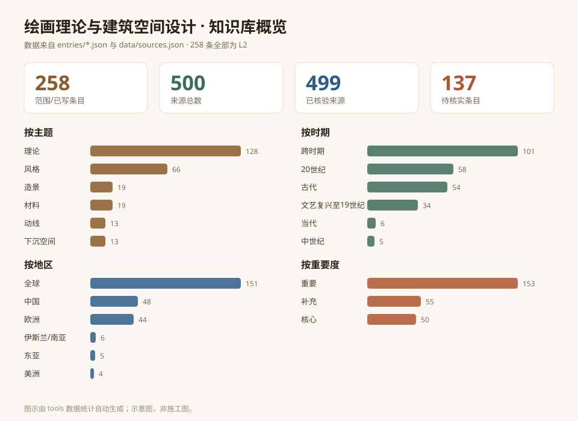

# 《绘画理论与建筑空间设计》静态知识库

一个可离线浏览、可机器校验的知识脉络库：把绘画理论与建筑空间设计放在同一张地图里，每条内容都能追溯到已核验的来源；查不到的事实一律标为「待核实」，不编造。



| 指标 | 数值 |
| --- | --- |
| 范围条目 / 已写条目 | 258 / 258（全部为 L2） |
| 来源总数 / 已核验 | 500 / 499 |
| 待核实条目 | 137（据实保留，不硬凑） |
| 质量闸 | `check.py` 0 errors · 23/23 测试 · 0 断链 · 0 孤儿 · 0 重复 |

## 在线预览

站点是纯静态页面（`site/`），只用相对链接，可直接发布到 GitHub Pages。

- 在线地址（需在仓库 Settings → Pages 把 Source 设为 **GitHub Actions**，由 `.github/workflows/pages.yml` 发布 `site/`）：
  <https://tiandihuang.github.io/shejihuihua/>
- 本地离线浏览：用浏览器打开 `site/index.html` 即可。

站点页面：

| 页面 | 内容 |
| --- | --- |
| `site/index.html` | 首页：指标卡片与按主题入口 |
| `site/indexes.html` | 按主题 / 时期 / 地区的索引 |
| `site/timeline.html` | 258 条按时期聚合的时间线 |
| `site/sources.html` | 来源库与链接状态 |
| `site/coverage.html` | 覆盖报告 |
| `site/entries/` | 258 个条目页（含自绘内联 SVG 示意图） |

## 工作方式

```
entries/*.json + data/sources.json
        │  tools/check.py       全量机器校验
        ▼
   tools/gen_site.py            确定性渲染
        ▼
   site/index.html …            纯静态站点
```

## 快速开始

```bash
python tools/check.py          # 全量校验
python tools/gen_site.py       # 生成 site/
python tools/check_links.py    # 站内链接核验
python -m unittest discover -s tests   # 单元测试
python tools/healthcheck.py    # 体检：断链 / 孤儿 / 重复
```

## 目录

- `scope.md`：全量范围清单（编辑基准线）
- `coverage.json` / `coverage-matrix.md`：覆盖状态与矩阵
- `data/sources.json`：全局来源库（`verified` 字段控制可引用性）
- `entries/*.json`：条目数据
- `tools/`：校验器、生成器、链接检查、体检
- `tests/`：校验器单元测试
- `site/`：生成的静态站点（不要手改）
- `docs/`：README 用的概览图（`overview.svg` / `overview.png`）
- `PROGRESS.md` / `DECISIONS.md` / `REPORT.md`：进度、决策与报告
- `SUMMARY.md`：项目总结（成果、架构、难点）
- `HANDOVER.md`：交接文档（环境搭建、改动流程、常见坑、自检清单）

## 硬性规则

1. 不编造数字、日期、人名、引文、出处；查不到写「待核实」。
2. 只引用 `data/sources.json` 中 `verified=true` 的来源。
3. 关键事实双源互证，否则标待核实；争议并列各方理由。
4. 不使用任何图片；所有图示为内联 SVG，并注明「示意图，非施工图」。
5. 尺寸/坡度/消防/无障碍数据仅作一般性说明，附「实际工程须按当地规范和专业设计人员的要求」。
6. 每轮最多处理 40 个条目；L1 未全部完成前不得深写个别条目。

## 项目状态

项目按自身规则只有「饱和」、没有「做完」：258 条已全部写到 L2，剩余的 137 条待核实条目多数找不到能直接证明的来源，据实保留。后续可选方向：新增条目、做 L3 深度、专项处理待核实池。

> 概览图由 `entries/*.json` 与 `data/sources.json` 的真实统计生成；示意图，非施工图。
